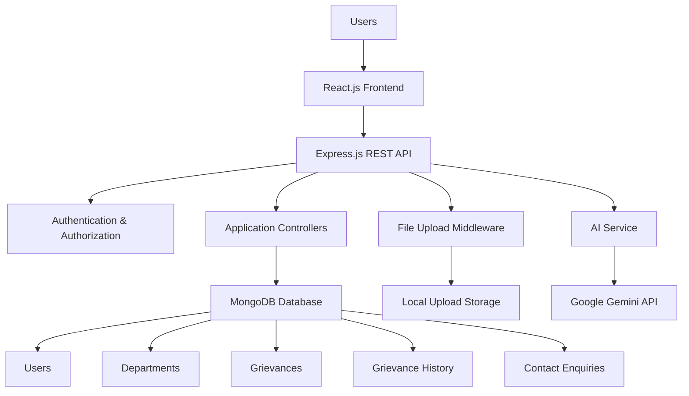
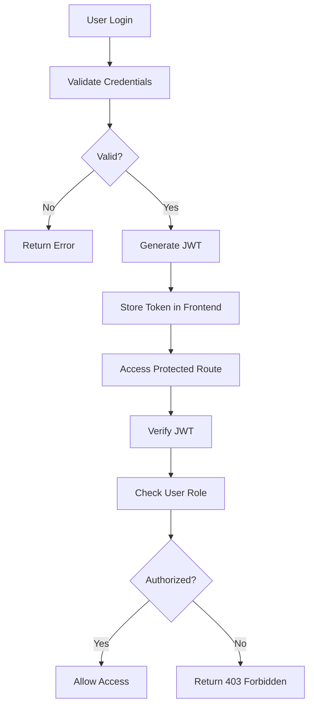
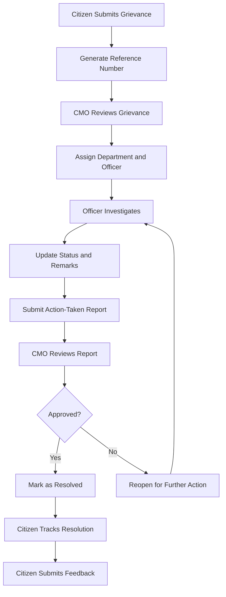

# System Architecture

## 1. Architecture Overview

The CM Kerala Public Grievance Redressal Portal follows a client-server architecture.

The frontend is developed using React.js, while the backend uses Node.js and Express.js to provide REST APIs. MongoDB is used for persistent data storage.

The frontend communicates with the backend through HTTP requests. JWT-based authentication and role-based authorization secure protected resources.

The application also integrates the Google Gemini API for AI-assisted grievance analysis.

## 2. High-Level Architecture



## 3. Frontend Architecture

The frontend is developed using React.js and Vite.

### Main Responsibilities

- Display public website pages.
- Provide registration and login interfaces.
- Display role-specific dashboards.
- Submit grievances and attachments.
- Communicate with backend REST APIs.
- Display grievance status and history.
- Provide AI analysis results.
- Display dashboards, charts, and statistics.

### Frontend Structure

```text
frontend/
│
├── src/
│   ├── components/
│   │   ├── admin/
│   │   ├── public/
│   │   └── ProtectedRoute.jsx
│   │
│   ├── pages/
│   │   ├── admin/
│   │   ├── citizen/
│   │   ├── officer/
│   │   ├── public/
│   │   └── auth/
│   │
│   ├── services/
│   │   ├── api.js
│   │   ├── authService.js
│   │   ├── adminService.js
│   │   └── citizenService.js
│   │
│   ├── App.jsx
│   └── main.jsx
│
└── package.json
```

### API Communication

Axios is used to communicate with the backend.

A centralized Axios instance manages the API base URL and automatically attaches the JWT token to authenticated requests.

## 4. Backend Architecture

The backend is developed using Node.js and Express.js.

It follows a modular structure that separates routes, controllers, models, middleware, and services.

### Main Responsibilities

- Handle HTTP requests and responses.
- Authenticate users.
- Authorize users based on roles.
- Manage grievance operations.
- Assign grievances to departments and officers.
- Maintain grievance status history.
- Handle file uploads.
- Integrate with the Gemini API.
- Store and retrieve application data.

### Backend Structure

```text
backend/
│
├── config/
│   └── db.js
│
├── controllers/
│   ├── authController.js
│   ├── grievanceController.js
│   ├── adminController.js
│   ├── officerController.js
│   ├── departmentController.js
│   └── contactController.js
│
├── middleware/
│   ├── authMiddleware.js
│   ├── roleMiddleware.js
│   └── uploadMiddleware.js
│
├── models/
│   ├── User.js
│   ├── Department.js
│   ├── Grievance.js
│   ├── GrievanceHistory.js
│   └── ContactEnquiry.js
│
├── routes/
│   ├── authRoutes.js
│   ├── grievanceRoutes.js
│   ├── adminRoutes.js
│   ├── officerRoutes.js
│   ├── departmentRoutes.js
│   └── contactRoutes.js
│
├── services/
│   └── aiService.js
│
├── uploads/
├── server.js
└── package.json
```

## 5. Database Architecture

MongoDB is used as the primary database, with Mongoose providing schema definitions and database operations.

The main collections are:

| Collection | Purpose |
|---|---|
| Users | Stores citizen, administrator, and officer accounts. |
| Departments | Stores department information. |
| Grievances | Stores complaint details, assignments, status, and resolution information. |
| GrievanceHistories | Maintains grievance status change history. |
| ContactEnquiries | Stores public contact form submissions. |

Relationships between collections are maintained using MongoDB ObjectId references.

## 6. Authentication and Authorization Flow

The application uses JWT-based authentication.

### Authentication Process

1. User enters email and password.
2. Backend validates the credentials.
3. Password is compared using bcrypt.
4. Backend generates a JWT token.
5. Token and user information are returned to the frontend.
6. Frontend stores the authentication information.
7. Axios attaches the token to protected API requests.
8. Backend middleware verifies the token.

### Role-Based Authorization

The application supports three roles:

- Citizen
- Admin
- Officer

Protected routes and backend middleware ensure that users can access only the resources permitted for their roles.



## 7. Grievance Processing Architecture

The grievance workflow involves three primary user roles.



Every grievance status change is recorded in the grievance history collection with the previous status, new status, responsible user, remarks, and timestamp.

## 8. AI Integration Architecture

The application integrates the Google Gemini API through a dedicated backend AI service.

### Processing Flow

1. Administrator requests AI analysis for a grievance.
2. Backend retrieves grievance details.
3. AI service retrieves available department information.
4. Complaint information is sent to the Gemini API.
5. Gemini generates structured analysis.
6. Backend validates the suggested department.
7. Analysis is stored with the grievance.
8. Administrator reviews the suggestions.

AI-generated suggestions include:

- Suggested department.
- Suggested category.
- Priority recommendation.
- Complaint summary.
- Possible duplicate identification.

AI does not automatically assign departments or make official grievance resolution decisions.

## 9. File Upload Architecture

Multer is used to handle grievance attachments.

The current implementation supports:

- JPEG
- PNG
- WEBP
- PDF
- DOC
- DOCX

File restrictions:

- Maximum file size: 5 MB.
- Maximum number of attachments: 3 per grievance.

Files are stored in the backend uploads directory, while attachment metadata and file URLs are stored with the grievance record.

For production deployment, authenticated file access and stronger file-content validation should be implemented.

## 10. External Integrations

| Integration | Purpose |
|---|---|
| Google Gemini API | AI-assisted grievance analysis. |
| MongoDB Atlas | Cloud database hosting (if configured). |
| Multer | Multipart file upload handling. |
| Axios | Frontend HTTP communication. |

## 11. Conclusion

The architecture separates frontend presentation, backend business logic, database operations, authentication, file handling, and AI integration.

This modular approach makes the application easier to maintain, test, and extend with additional features.