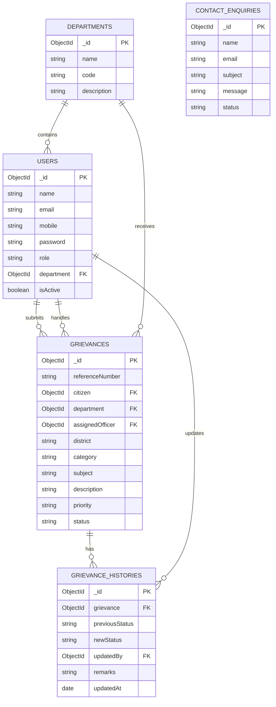

# Database Design

## 1. Overview

The CM Kerala Public Grievance Redressal Portal uses MongoDB as its primary database.

Mongoose is used to define schemas, validate data, and manage relationships between collections.

The application uses five primary collections:

1. Users
2. Departments
3. Grievances
4. GrievanceHistories
5. ContactEnquiries

## 2. Database Collections

### 2.1 Users Collection

Stores information about citizens, administrators, and department officers.

| Field | Data Type | Description |
|---|---|---|
| _id | ObjectId | Unique user identifier |
| name | String | User's full name |
| email | String | User's email address |
| mobile | String | Contact number |
| password | String | Bcrypt-hashed password |
| role | String | citizen, admin, or officer |
| department | ObjectId | Reference to Departments |
| isActive | Boolean | Account activation status |
| createdAt | Date | Account creation timestamp |
| updatedAt | Date | Last update timestamp |

**Role values:**
- citizen
- admin
- officer

The department field is primarily used for officer accounts.

### 2.2 Departments Collection

Stores information about the departments responsible for handling grievances.

| Field | Data Type | Description |
|---|---|---|
| _id | ObjectId | Unique department identifier |
| name | String | Department name |
| code | String | Department code |
| description | String | Department description |
| categories | Array | Related grievance categories |
| createdAt | Date | Creation timestamp |
| updatedAt | Date | Last update timestamp |

Sample departments include:

- Public Works Department
- Health Department
- Education Department
- Police Department
- Water Resources Department
- Electricity Department
- Transport Department
- Local Self Government Department

### 2.3 Grievances Collection

Stores all citizen complaints and their processing information.

| Field | Data Type | Description |
|---|---|---|
| _id | ObjectId | Unique grievance identifier |
| referenceNumber | String | Unique grievance tracking number |
| citizen | ObjectId | Reference to Users |
| district | String | Kerala district |
| category | String | Grievance category |
| subject | String | Complaint subject |
| description | String | Detailed complaint |
| department | ObjectId | Assigned department |
| assignedOfficer | ObjectId | Assigned officer |
| priority | String | Low, Medium, or High |
| status | String | Current grievance status |
| aiAnalysis | Object | AI-generated suggestions |
| attachments | Array | Uploaded attachment metadata |
| investigationRemarks | String | Officer investigation notes |
| actionTakenReport | String | Officer's action report |
| reportSubmittedAt | Date | Report submission timestamp |
| resolutionDetails | String | Resolution information |
| feedback | Object | Citizen feedback |
| createdAt | Date | Submission timestamp |
| updatedAt | Date | Last update timestamp |

**Grievance status values:**

- Submitted
- Under Review
- In Progress
- Resolved
- Reopened

**AI Analysis Object:**

The AI analysis stores the following suggested information:

- suggestedDepartment
- suggestedCategory
- priority
- summary
- possibleDuplicate

These values are recommendations and do not automatically replace official grievance decisions.

**Attachments Object:**

Each attachment contains metadata such as:

- originalName
- fileName
- fileUrl
- mimeType
- size

**Feedback Object:**

Citizen feedback may contain:

- rating
- comment
- submittedAt

### 2.4 GrievanceHistories Collection

Maintains an audit trail of grievance status changes.

| Field | Data Type | Description |
|---|---|---|
| _id | ObjectId | Unique history identifier |
| grievance | ObjectId | Reference to Grievances |
| previousStatus | String | Previous grievance status |
| newStatus | String | Updated grievance status |
| remarks | String | Reason or remarks |
| updatedBy | ObjectId | Reference to Users |
| updatedAt | Date | Status update timestamp |

This collection provides transparency and helps track the complete grievance lifecycle.

### 2.5 ContactEnquiries Collection

Stores messages submitted through the public Contact page.

| Field | Data Type | Description |
|---|---|---|
| _id | ObjectId | Unique enquiry identifier |
| name | String | Sender's name |
| email | String | Sender's email |
| subject | String | Enquiry subject |
| message | String | Enquiry message |
| status | String | New, Reviewed, or Closed |
| createdAt | Date | Submission timestamp |
| updatedAt | Date | Last update timestamp |

## 3. Collection Relationships

The database uses ObjectId references to connect related documents.

### Relationship Overview

| Source Collection | Field | Target Collection | Relationship |
|---|---|---|---|
| Users | department | Departments | Many users can belong to one department |
| Grievances | citizen | Users | Many grievances can belong to one citizen |
| Grievances | department | Departments | Many grievances can be assigned to one department |
| Grievances | assignedOfficer | Users | One officer can handle multiple grievances |
| GrievanceHistories | grievance | Grievances | One grievance can have multiple history records |
| GrievanceHistories | updatedBy | Users | One user can create multiple history records |

## 4. Entity Relationship Diagram

## 5. Data Validation and Constraints

The application uses Mongoose schema validation to maintain data consistency.

Important constraints include:

- User email addresses must be unique.
- Grievance reference numbers must be unique.
- Required grievance fields must be provided.
- User roles must match the allowed role values.
- Grievance statuses must match the predefined statuses.
- Priority must be Low, Medium, or High.
- Department and user references must point to valid records where applicable.

## 6. Data Security

- Passwords are stored as bcrypt hashes.
- Password fields are excluded from normal query results.
- JWT authentication protects private APIs.
- Role-based access controls data operations.
- Environment variables store database credentials.
- Sensitive information should not be exposed through public grievance tracking responses.

## 7. Conclusion

The MongoDB database design separates user accounts, departments, grievances, status history, and contact enquiries into dedicated collections.

ObjectId references maintain relationships between records, while the grievance history collection provides traceability throughout the complaint resolution process.