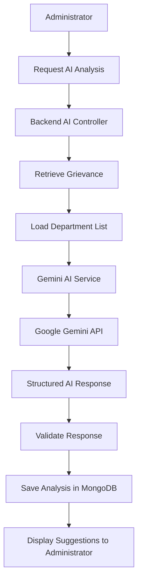

# AI Integration Documentation

## 1. Overview

The CM Kerala Public Grievance Redressal Portal integrates Google's Gemini API to provide AI-assisted grievance analysis.

The AI assistant helps administrators understand complaints, identify relevant departments, recommend priority levels, and generate concise summaries.

The integration is implemented using the Google GenAI SDK in the Node.js backend.

## 2. Technology Used

| Technology | Purpose |
|---|---|
| Google Gemini API | AI-powered complaint analysis |
| Google GenAI SDK | Backend integration with Gemini |
| Node.js | AI service execution |
| Express.js | AI analysis API endpoint |
| MongoDB | Store AI-generated analysis |

## 3. AI Features

The application supports the following AI-assisted capabilities.

### 3.1 Department Recommendation

The AI analyzes the complaint description and suggests the most relevant department based on the available department list.

Example:

Input:
"Roads in our residential area are severely damaged and need immediate repair."

Suggested department:
Public Works Department.

### 3.2 Category Recommendation

The AI identifies a suitable grievance category based on the complaint content.

### 3.3 Priority Recommendation

The AI recommends one of three priority levels:

- Low
- Medium
- High

Priority recommendations are based on the nature and potential impact of the complaint.

### 3.4 Complaint Summary

The AI generates a short summary of the complaint to help administrators understand the issue quickly.

### 3.5 Duplicate Complaint Detection

The AI can identify whether a complaint appears potentially similar to another grievance.

This is an initial AI-based indication and does not replace a dedicated duplicate-detection system.

## 4. AI Processing Architecture

The AI analysis follows this process:

1. Administrator opens a grievance.
2. Administrator requests AI analysis.
3. Backend retrieves grievance information.
4. AI service loads the available departments.
5. Complaint details and department information are sent to Gemini.
6. Gemini analyzes the complaint.
7. Backend processes and validates the structured response.
8. AI analysis is stored in MongoDB.
9. Administrator reviews the suggestions.



## 5. AI Prompt Processing

The backend sends structured instructions to Gemini.

The prompt includes:

- Grievance subject.
- Grievance description.
- Available department names.
- Expected response format.
- Priority classification requirements.

The AI is instructed to return structured JSON containing:

```json
{
  "suggestedDepartment": "Public Works Department",
  "suggestedCategory": "Road",
  "priority": "High",
  "summary": "The citizen reports damaged roads requiring repair.",
  "possibleDuplicate": false
}
```

The response is processed by the backend before being saved.

## 6. AI Response Validation

The backend validates the AI-generated information before storing it.

Validation includes:

- Checking whether the suggested department exists.
- Checking the expected priority values.
- Processing the expected JSON structure.
- Handling invalid or incomplete AI responses.

Department suggestions are matched against the available departments stored in MongoDB.

## 7. Human Review and Decision Making

AI suggestions are provided only as decision-support information.

The administrator remains responsible for:

- Reviewing AI suggestions.
- Confirming the appropriate department.
- Assigning the responsible officer.
- Confirming priority and processing decisions.
- Approving grievance resolution.

AI does not automatically assign officers or resolve grievances.

## 8. Error Handling and Fallback

External AI services may occasionally be unavailable because of network problems, service overload, or API quota restrictions.

The application handles these situations through error handling.

When AI analysis is unavailable:

- The application displays an appropriate error or fallback message.
- The grievance remains available for manual review.
- Administrators can continue the grievance workflow without AI analysis.
- AI failure does not prevent grievance submission.

Example fallback message:

"AI analysis unavailable. Manual review required."

Retryable errors, including temporary service unavailability and rate-limit responses, should be handled appropriately.

## 9. API Integration

The AI analysis endpoint is:

```http
POST /api/admin/grievances/:id/analyze
```

Access is restricted to authenticated administrators.

The endpoint retrieves the grievance, invokes the AI service, and stores the generated analysis.

## 10. API Key Security

The Gemini API key is stored in the backend environment configuration.

Example:

```env
GEMINI_API_KEY=your_gemini_api_key
GEMINI_MODEL=your_configured_gemini_model
```

The API key must never be exposed in frontend code or committed to GitHub.

## 11. Limitations

The AI integration has the following limitations:

- AI-generated suggestions may occasionally be inaccurate.
- Department recommendations require administrator verification.
- Duplicate detection is preliminary and may produce false positives or negatives.
- API quotas and service availability can affect response generation.
- AI analysis depends on the quality of complaint descriptions.

## 12. Conclusion

The Gemini integration demonstrates how generative AI can assist public grievance management by summarizing complaints, recommending departments, and suggesting priority levels.

The system combines AI-assisted analysis with human decision-making to maintain administrative control and accountability.